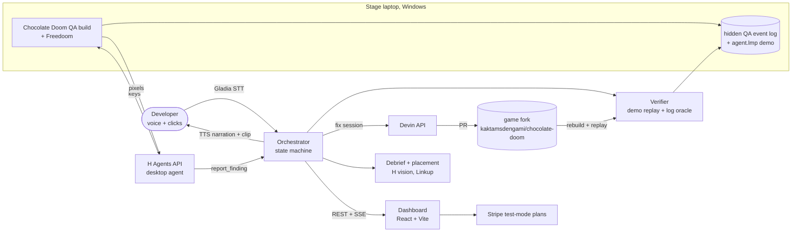

# PLAYER TWO

**An H desktop agent plays real Doom from pixels like a hostile QA tester, finds a visual bug,
proves it, explains it by voice, and gets it fixed by the Devin API.**

Built at the H Company × 42AI Computer Use Agents Hackathon (Paris, November 2026) with the
H Agents API, Devin, Gladia, Linkup and Stripe.

## Try it now (jury link)

**https://establishment-era-zen-guides.trycloudflare.com/** — no install, no login.

- **TESTER MODE · `/arcade/`** — H Company's Holo plays Doom live in your browser: it looks at the
  pixels, says what it sees, presses the keys. A short scripted *tester briefing* (labelled as such in
  the move log) walks the known route to the first door, then Holo is on its own. Every page says LIVE
  or RECORDED: when the shared H API budget is spent or no key is set, the page replays a recorded
  Holo run and says so. **INSERT COIN** hands you the controls; give them back any time.
- **KID MODE · `/kid/`** — you play, Pixel (Holo eyes, ElevenLabs voice, Gladia ears) watches the
  screen and talks with you.
- **`/pricing/`** — KID €5 and PRO €49 subscriptions through real Stripe Checkout (test mode, card
  4242 4242 4242 4242).
- `/live/`, `/lab/`, `/story/` — the same engine in three more looks; `/dashboard/` — the full tester
  dashboard (bug hunt, Devin fix loop, debrief, placement scout).

Self-host: `uv run uvicorn app.main:app --port 8000` with `HAI_API_KEY`, `ELEVENLABS_API_KEY`,
`GLADIA_API_KEY`, `LINKUP_API_KEY`, `STRIPE_SECRET_KEY` in `.env`, then `cloudflared tunnel --url
http://127.0.0.1:8000` (or `scripts\jury_up.ps1` on Windows). The link above lives as long as the
demo machine does.

## The loop

1. **Play.** An H Agents API desktop agent (model `holo4-35b-a3b`) plays real
   **Chocolate Doom + Freedoom** on a real Windows desktop. It sees only screenshots and presses
   keys. A QA frame-step mode lets the game wait for each agent action.
2. **Find.** When something looks wrong, the agent calls its custom tool `report_finding` (what,
   where, steps, expected vs actual). It never sees the known-bug list or the game's event log.
3. **Verify.** The verifier replays the **agent's own demo** (`agent.lmp`, vanilla Doom demo
   recorded during play) and checks a **hidden QA event log** written by our fork against log
   signatures. Only a verified finding reaches the developer, with a clip of the replay.
4. **Explain.** Voice narration over the clip; the developer answers by voice (Gladia real-time
   STT) or button: fix, skip, explain, stop.
5. **Fix.** On "fix", the product opens a **Devin API session** with the finding, steps and a log
   excerpt. Devin opens a PR on the game fork; the developer's approval merges it.
6. **Prove.** The game is rebuilt and the same steps are replayed: fixed or not fixed.
7. **Debrief.** Deaths heatmap, design notes with Linkup references, and product-placement spots
   with brand candidates. Dashboard shows the whole run live.

## Architecture



Code: `agents/` (tester, verifier, fix loop), `launcher/` (game, frame-step, replay, clips),
`devin/` (API client), `voice/`, `insights/`, `app/` (FastAPI + orchestrator), `web/`
(dashboard). Details: [docs/PLAN.md](docs/PLAN.md), [docs/GAME.md](docs/GAME.md),
[docs/CONTRACTS.md](docs/CONTRACTS.md).

## Results (honest)

All from stage-laptop runs; run records in [eval/runs/](eval/runs/), details in
[eval/RESULTS.md](eval/RESULTS.md).

| Run | Mode | Result |
|---|---|---|
| Stage run 2 | **Blind** (no test plan) | First blind rediscovery: 4 findings, verifier **verified KB4** (long-wall wobble) from the QA log; the other 3 stayed suspected. |
| Stage run 4, preset `stage-play` | **Spec-based** (visible developer test plan) | 37 actions, 1107 game tics; picked up a shotgun, the invulnerability sphere and bullets; `report_finding` "Sky not inverted during invulnerability power-up". Demo replay 31/31 player samples identical. Verifier: **verified, KB3**, replay `demo`, 10 s clip. |
| KB3 Devin fix | Devin session from that finding | Fork PR #2, CI green, not merged; scripted replay: 1 → 0 `sky_ignores_colormap` events. |
| Full live loop, preset `stage-play` | **Spec-based**, started from the dashboard | H found the sky bug, verifier **verified KB3**, narration, Fix (dashboard button) → Devin opened fork [PR #4](https://github.com/kaktamsdengami/chocolate-doom/pull/4) in 2 min → merged → fork CI Windows build → scripted replay: 0 `sky_ignores_colormap` events, grey sky → **FIXED**, 7 min 18 s from Fix to FIXED. 95 agent actions, 0 clicks. |

- **Blind vs spec-based.** Stage presets (`stage-play`, `stage-kb3`) give the agent a visible
  developer test plan that states the expected behaviour under invulnerability. Those runs are
  spec-based testing, not blind rediscovery. Only the KB4 run was blind.
- **Real bugs.** KB1–KB4 are documented vanilla Doom defects that Chocolate Doom keeps on purpose
  (sources in `eval/known_bugs.yaml`, hidden from the tester). KB3 is id Software's original
  "sky not affected by invulnerability" behaviour in `r_plane.c`; there is no upstream fix to copy.
- **Devin fix for the H-found KB3 (RECORDED):** the stage run 4 finding, sent with the product's
  prompt `devin/prompts/fix_bug.md` to a Devin session, gave fork
  [PR #2](https://github.com/kaktamsdengami/chocolate-doom/pull/2) (`r_plane.c` +15/-5: the sky
  uses `fixedcolormap` when set; CI green, not merged). Scripted QA replay on E3M1: before, 1
  `sky_ignores_colormap` event and a red sky; after, 0 events and a grey sky like the rest of the
  scene. That session was started from the orchestrator's Devin session on the Devin VM, not by
  `app.main` on the laptop.
- **Full live loop (RECORDED, stage laptop):** the same loop ran end to end through `app.main`
  live, from a dashboard click to FIXED (run record
  [eval/runs/2026-11-08-stage-live-loop-fixed.json](eval/runs/2026-11-08-stage-live-loop-fixed.json)).
  The fix was approved with the dashboard button; voice "fix it" was tested separately (9/9 in the
  mic test), not inside that run. KB3 has no upstream fix, so there is no upstream comparison.
- Demo content is marked **LIVE** (a real run happening now) or **RECORDED** (a saved run replayed
  from its `events.jsonl`) in the dashboard.

## How to run

**Mock mode (any machine, no keys):**

```bash
uv sync --extra dev && .venv/bin/pytest -q      # Python 3.12
cd web && npm ci && npm run dev                 # dashboard on mock data, labelled MOCK DATA
```

RECORDED mode replays a saved run: `python -m app.main --mode recorded --recording <events.jsonl>`
and `VITE_API_BASE=http://localhost:8000 npm run dev`.

**Live mode (stage laptop only):** needs the Windows laptop with the H desktop agent, the
microphone, the fork's QA build (`python -m launcher fetch`) and Freedoom, plus the keys in
[.env.example](.env.example) (`HAI_API_KEY`, `DEVIN_API_KEY`, `DEVIN_ORG_ID`, `GLADIA_API_KEY`,
`LINKUP_API_KEY`, Stripe test keys).

```bash
python -m agents.tester --preset stage-play     # one tester run -> recordings/<run>/
python -m agents.verifier recordings/<run>      # demo replay + log oracle
python -m app.main --mode live --start          # full loop, with the dashboard
```

## Credits and licences

- [Chocolate Doom](https://github.com/chocolate-doom/chocolate-doom) 3.1.1, GPL-2.0, by Simon
  Howard and contributors, based on the id Software source release. Our QA fork:
  [kaktamsdengami/chocolate-doom](https://github.com/kaktamsdengami/chocolate-doom), branch
  `player-two-qa`, licence unchanged.
- [Freedoom](https://freedoom.github.io/) 0.13.0, BSD-3-Clause, by the Freedoom project.
  Downloaded at build time, never committed.
- Bug write-ups: [Doom Wiki](https://doomwiki.org/). Reference fixes:
  [Crispy Doom](https://github.com/fabiangreffrath/crispy-doom) (GPL-2.0).
- All product code was written by Devin sessions; rules for coding agents in [AGENTS.md](AGENTS.md),
  live build state in [docs/HANDOFF.md](docs/HANDOFF.md).
